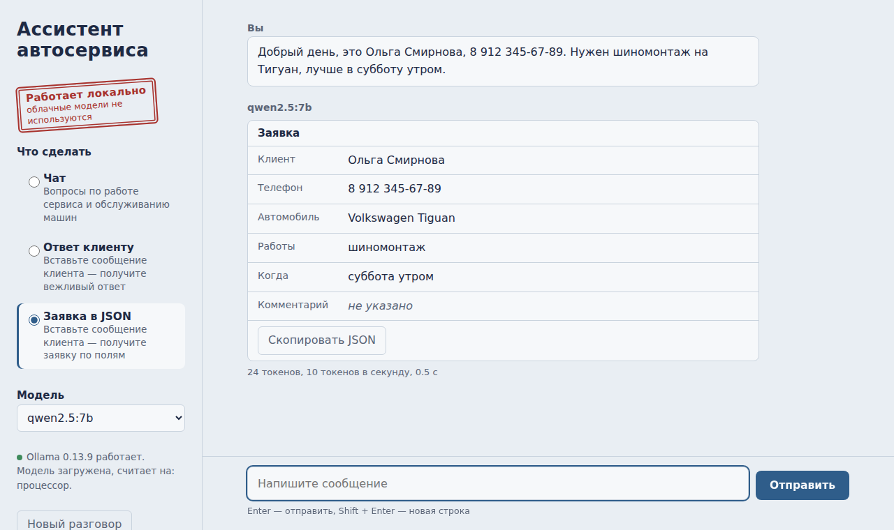

# День 27. Интеграция локальной LLM в приложение

**«Ассистент автосервиса»** — веб-приложение, которое работает с локальной моделью
через Ollama. Ответы печатаются по мере генерации, облачные модели не используются.



## Как устроено

```
Браузер ──► server.py (127.0.0.1:8000) ──► Ollama (localhost:11434) ──► qwen2.5:7b
   ▲                                                                       │
   └────────────── ответ приходит потоком, по кускам ◄─────────────────────┘
```

| Файл | Роль |
|---|---|
| `server.py` | сервер приложения на стандартной библиотеке Python: отдаёт страницу, передаёт запросы в Ollama и стримит ответ обратно |
| `index.html` | интерфейс: одна страница без внешних ресурсов |
| `run.ps1` | проверяет Ollama и модель, запускает приложение, открывает браузер |

Устанавливать пакеты не нужно — только Python и Ollama.

## Режимы

| Режим | Что делает | Как |
|---|---|---|
| **Чат** | вопросы по работе сервиса и обслуживанию машин | с историей последних 12 сообщений |
| **Ответ клиенту** | вежливый ответ на сообщение клиента | цены и сроки модель не выдумывает — пишет `[уточнить]` |
| **Заявка в JSON** | раскладывает сообщение клиента по полям: клиент, телефон, машина, работы, когда | Ollama `format: json` — модель обязана вернуть корректный JSON; результат показывается карточкой с кнопкой копирования |

## Без облака — по построению

- адрес модели обязан указывать на этот компьютер (`localhost`, `127.0.0.1`, `::1`),
  иначе сервер откажется запускаться — проверено на `https://api.openai.com`;
- сервер приложения слушает только `127.0.0.1` — с других устройств к нему не подключиться;
- страница не загружает ничего из интернета: системные шрифты, свои стили и скрипт.

Данные клиентов — имена, телефоны, машины — не покидают компьютер.

## Оформление

Палитра заказ-наряда под копирку: бледно-голубая бумага, тёмно-синие «чернила»,
красный только у штампа «Работает локально». Заголовки — Bahnschrift: он есть в каждой
Windows 10/11 и построен на DIN, шрифте дорожных и автомобильных табличек.
Светлая и тёмная тема — по настройке системы; работает с клавиатуры и в узком окне.

## Что проверено

На имитации Ollama, отвечающей потоком, как настоящая, и в браузере Chromium:
- ответ появляется по частям; на время генерации кнопка становится «Остановить»;
- в чате история уходит модели, в двух других режимах — только последнее сообщение;
- заявка: `format=json`, карточка с полями, копирование JSON;
- разметка из ответа модели показывается текстом и не выполняется (``);
- понятные ошибки: Ollama выключена, модель не скачана, пустое сообщение;
- светлая, тёмная тема и узкий экран; ошибок JavaScript нет.

С настоящей моделью приложение не запускалось — это делает ваш компьютер.

## Запуск (PowerShell)

```powershell
cd "путь\до\day27-local-llm-app"
Unblock-File .\run.ps1
.\run.ps1
```

Браузер откроется сам на `http://127.0.0.1:8000`. Остановить — `Ctrl+C` в окне PowerShell.

## Проверка ТЗ

| Пункт ТЗ | Где |
|---|---|
| Интегрировать локальную модель в приложение | веб-приложение: `server.py` + `index.html` |
| Приложение отправляет запросы в локальную LLM | `POST /api/chat` → Ollama `localhost:11434` |
| Получает и отображает ответы | потоковый вывод в браузере, карточка заявки |
| Работает без облачных моделей | проверка адреса модели, сервер только на 127.0.0.1, без внешних ресурсов |
